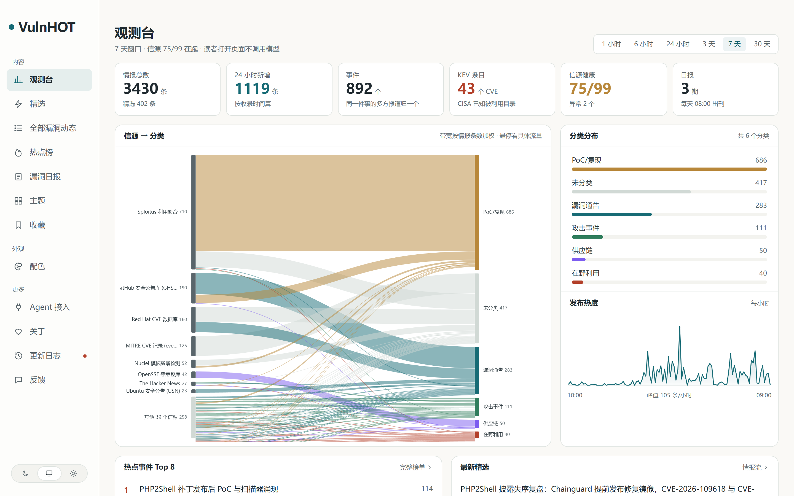
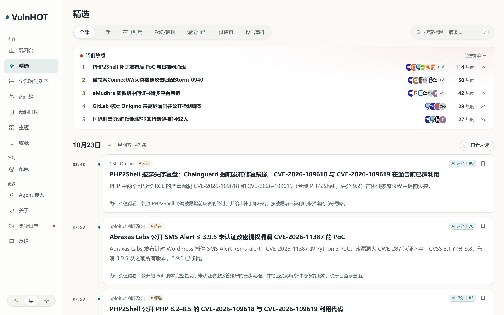

<div align="center">

<picture>
  <source media="(prefers-color-scheme: dark)" srcset="docs/assets/vulnhot-home-dark.png">
  
</picture>

<h1>VulnHOT · 漏洞情报热点站</h1>

<p>
每天自动采集全球漏洞情报，用模型判断哪些值得看、写成中文摘要，把同一个漏洞的多方报道归成一个事件，
按「今天要不要动手」排序，出日报。<br>
<b>网页 · RSS · 公开 API · MCP · llms.txt 同时服务于人和 Agent。</b>
</p>

<p>
  <a href="https://vulnhot.com"></a>
  <a href="https://vulnhot.com/feed.xml"></a>
  <a href="https://vulnhot.com/api/v1/agent"></a>
  <a href="https://vulnhot.com/agent"></a>
  <br>
  <a href="https://github.com/Fmttm221/vulnhot/actions/workflows/check.yml"></a>
  
  
  
  
</p>

</div>

> 如果这个站帮你少看了几个群、少翻了几次公告，去 [给仓库点个 Star](https://github.com/Fmttm221/vulnhot) 就是最实在的支持 —— 也让我知道这件事值得继续做。

**面向读者**：同时站在攻防两侧的安全从业者。守方要回答「这个洞会不会轮到我、现在该做什么」，渗透测试与红队要回答「哪个洞现在真有能用的 PoC、目标是不是我手上的组件」。

---

## 打开就能看

| 入口 | 地址 | 里面是什么 |
|---|---|---|
| **观测台** | <https://vulnhot.com/> | 一页看完：信源→分类的流向、分类分布、发布热度曲线、现在最该看的几条 |
| **精选情报流** | <https://vulnhot.com/featured> | 按天分组、可折叠、支持离线回退的阅读区，每条都有「为什么值得看」 |
| **全部漏洞动态** | <https://vulnhot.com/all> | 未筛的全部采集结果，可按类别、标签、关键词查 |
| **热点榜** | <https://vulnhot.com/hot> | 按事件计算的热度：48 小时内同一来源只计一次，24 小时减半 |
| **漏洞日报** | <https://vulnhot.com/daily> | 每天 08:00 出刊，规则编排、不调模型；周报月报从日报汇编 |
| **RSS** | <https://vulnhot.com/feed.xml> | 精选流、全部流、分类流、日报/周报/月报，各有独立地址 |
| **公开 API v1** | <https://vulnhot.com/openapi-v1.json> | 匿名只读、无需 token：条目、事件、热点、日报、周报 |
| **MCP / Agent** | <https://vulnhot.com/agent> · <https://vulnhot.com/llms.txt> | 把站接进你的 Agent：MCP 工具、Agent Markdown、字段说明 |

<p align="center">
  
</p>

## 它做什么

```
信源 → 采集(判重·抓原文) → 预筛 → 独立两次评分 → 写作 → 结构化 → 归组(事件·热度)
                                                          ↓
                                    公开读取层 publication/（单一出口）
                                                          ↓
                        日报 · 周报 · 月报 · 网页 · RSS · API v1 · MCP · llms.txt · 站点地图
```

- **判重**：URL、标题指纹、正文重合多层判重，同一个 PoC 被几十个聚合站转发也只算一条。
- **双次独立评分**：同一份标准独立打两次分，两次之和 ≥ 2×门槛才入选，抗单次评分抖动。
- **事件聚簇**：向量召回候选 → 模型判定「同一次发生 / 后续进展 / 两件事」→ 写入前二次复核。**同一个漏洞编号被多方报道算同一次发生。**
- **热度算法**：按事件而非文章计算，跨来源去重。
- **日报不调模型**：纯规则编排；周报月报从日报汇编，模型只写总述。
- **Agent 原生**：MCP 工具、`/api/v1/agent`、`llms.txt`、条目 Markdown 都能直接给 Agent 用。
- **只读不越界**：读者打开页面不触发任何模型调用；公开内容全部匿名，后台只允许管理员。

## 漏洞行业的判断口径

- **分类**：在野利用 / PoC·复现 / 漏洞通告 / 供应链 / 攻击事件。
- **五轴打分**：`sig` 实质份量、`nov` 信息增量、`cred` 证据强度、`reson` 影响面、`act` 可处置性，按 6 类内容类型给不同权重。
- **硬规则**：不得由「高危」「严重」「紧急」「CVSS 9.8」推断出「已在野利用」「已复现」「可直接利用」——这些状态只有原文明确写出时才成立。
- **简短不扣分**：CISA KEV 新增一条、厂商一句「已确认在野利用」、一个只有编号和受影响版本的 PoC 仓库，都是最短也最有用的材料。

## 信源

**99 个信源，75 个在跑**（其余等凭据或按需启用），按类别覆盖：

| 类别 | 例子 |
|---|---|
| 权威漏洞库 | NVD、CISA KEV、GHSA、MITRE CVE、Red Hat CVE、OSV、EPSS、OpenSSF 恶意包 |
| 厂商与 CERT | Microsoft MSRC、Mozilla、Apple、Fortinet PSIRT、Ivanti、Drupal、Jenkins、Kubernetes、Ubuntu、Debian、PHP、nginx、OpenSSL、NCSC-UK |
| 安全研究 | Google TAG、Project Zero 系博客、Talos、Unit 42、ZDI、Qualys、Rapid7、Tenable、SonarSource、Trail of Bits、watchTowr、Exodus Intelligence、PortSwigger、Check Point、Cloudflare |
| 一线报道 | The Hacker News、BleepingComputer、SecurityWeek、The Record、Krebs、SANS ISC、CyberScoop、CSO Online、Security Affairs、Malwarebytes、Graham Cluley、Risky Business、Hackread、Infosecurity |
| PoC 与利用 | Exploit-DB、Sploitus、Nuclei 模板、GitHub 安全研究仓库 |
| 国内 | 安全客、4hou、绿盟、Sebug、SecPulse、安恒 TI、CNVD/CNNVD 推送 |

抓取节奏按源 10–360 分钟不等，RSS 走 `ETag`/`Last-Modified` 条件请求，大部分轮次只收到 304。

**在大陆网络里怎么抓境外源**：Google 系被丢包、几家大站还有 Cloudflare 托管挑战，所以 `EGRESS_PROXY_URL` 是必需的；但它是全局开关，直接全量绕道会让国内源变慢甚至抓不到。本站的做法是「已实测可直连的主机走直连（`DEPLOYMENT.directFetchHosts`）、只有必须出境的请求才走代理」，每次跳转按目标域名重新选路。见 [`docs/deploy.md`](docs/deploy.md) 的「在中国大陆的服务器上」。

## 快速开始

```bash
# 1) 生成 .env（会打印一次管理员密码）
node scripts/init-env.ts

# 2) 在 .env 里填模型：LLM_BASE_URL / LLM_API_KEY / LLM_MODEL（任何 OpenAI 兼容接口）

# 3) 启动（需要 Docker）
docker compose up -d --build        # http://localhost:3000，后台在 /admin
```

开发时把 `COLLECT_ENABLED`、`MODEL_CALLS_ENABLED` 关掉，只跑本地数据。不用 Docker 的本机跑法与验收命令见 [`VULNHOT.md`](VULNHOT.md) 第 5 节。

## 部署

`docker compose` 一把起（db / api / worker / web 四个容器），域名与 HTTPS、境外信源出口、升级与排错都在 [`docs/deploy.md`](docs/deploy.md)。

## 部署前必做的两件事

1. **改条款与隐私说明**：`site/pages/terms.md`、`site/pages/privacy.md` 是模板，运营主体、联系方式、生效日期必须由运营者本人确认后填写（必要时请专业人士审阅）。
2. **校准入选门槛**：`industry/selection.ts` 里的 58/62/72 是起手值，要用自己标注的样本跑 `scripts/eval-selection.ts` 重新校准，否则「选得准不准」没有依据。

## 目录

| 位置 | 内容 |
|---|---|
| `site/` | 站名文案 `site.ts`、逐步模型 `models.ts`、品牌 `brand/`、条款页 `pages/`、根目录固定文件 `public/`、更新日志 `changelog.json` |
| `industry/` | 分类标签 `taxonomy.ts`、主题 `topics.json`、信源 `sources.json`、提示词 `prompts/`、门槛 `selection.ts` |
| `modules/<名字>/` | 本站专属功能（一个功能一个 npm 包）：观测台主题、漏洞视角写作、信号接入 |
| `apps/api` `apps/worker` `apps/web` | Fastify 接口 · 定时任务与队列 · React Router SSR（**不改**） |
| `packages/backend` `packages/contracts` | 业务实现与共享类型（**不改**） |
| `database/migrations/` | 数据库迁移，按完整文件名排序执行 |

## 文档

| 文档 | 内容 |
|---|---|
| [`VULNHOT.md`](VULNHOT.md) | 本站自己的全部决定：读者定位、改动清单、信源复审、还差什么、怎么跑 |
| [`docs/deploy.md`](docs/deploy.md) | 标准 Docker 部署、升级、排错 |
| [`docs/sources.md`](docs/sources.md) · [`docs/selection.md`](docs/selection.md) · [`docs/grouping.md`](docs/grouping.md) | 信源、精选门槛、事件归组的规则 |
| [`AGENTS.md`](AGENTS.md) · [`docs/architecture.md`](docs/architecture.md) | 给 Agent 的约定与整体架构 |
| [`README.en.md`](README.en.md) | 上游框架的英文说明 |

## 许可与致谢

代码 MIT（见 [`LICENSE`](LICENSE)）。引擎来自 [AIHOT](https://github.com/KKKKhazix/AIHOT)（MIT）：本仓库是它的 fork，`apps/` 与 `packages/` 一行未改，改造全部落在 `site/`（站点身份）与 `industry/`（行业包），因此可以持续合并上游更新。

AIHOT 的名称与 Logo 不在其 MIT 授权范围内，本仓库使用自己的名称与图标（见 [`NOTICE`](NOTICE)）。站内展示的标题与摘要由模型根据公开来源生成，原文版权归各来源所有；本站不托管、不分发漏洞利用代码，默认只展示摘要与原文链接。
